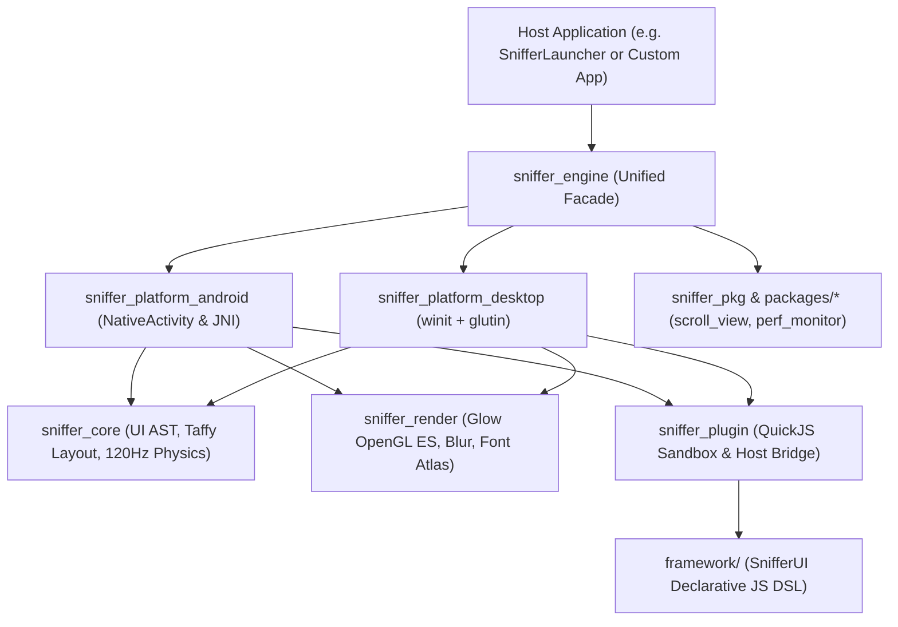

# SnifferEngine

> A general-purpose, declarative 120Hz embedded UI, physics, and graphics engine written in Rust, powered by a sandboxed QuickJS (`SnifferUI`) plugin runtime and OpenGL ES / Glow rendering.

[](https://github.com/GreenKod/snifferengine/actions/workflows/check.yml)
[](https://www.rust-lang.org/)
[](#requirements)
[](LICENSE)

SnifferEngine provides a single unified Rust facade (`sniffer_engine`) and a zero-boilerplate JavaScript UI DSL (`SnifferUI`) for building high-frame-rate, physics-driven native applications on Android (`NativeActivity`) and Desktop (`winit` + `glutin`) without a JVM, WebView, or Gradle stack.

---

## Key Capabilities

- **120Hz Native Physics & Transitions:** Analytical critically/under-damped spring solver (`TransitionManager`), friction/fling momentum scrolling, rubber-band overscroll, horizontal/vertical page snapping, and configurable `ScrollDismissConfig` handoff gestures.
- **Zero-Boilerplate Declarative JS UI (`SnifferUI`):** Write reactive UI plugins in vanilla JavaScript (`SnifferUI.start`, `SnifferUI.setState`, `SnifferUI.on`) executed inside a memory-capped, watchdog-protected QuickJS runtime with direct Rust AST deserialization (`host_set_ui_fast`).
- **OpenGL ES 3.0 / Glow Renderer:** Instanced geometry batching, SDF and color emoji font atlas caching, multi-pass Dual-Kawase frosted glass backdrop blur, and hierarchical scissor/stencil clipping.
- **Single Facade Crate:** Host applications depend only on `sniffer_engine` (`sniffer_engine::prelude::*`, `sniffer_engine::run_desktop()`, `sniffer_engine::run_android(app)`).
- **Versioned C ABI Native Packages:** Extend the engine with dynamically verified `.so` / `.dll` native packages (`sniffer_pkg`).

---

## Architecture



### Workspace Crates

| Crate / Directory                                                    | Responsibility                                                                                                |
| -------------------------------------------------------------------- | ------------------------------------------------------------------------------------------------------------- |
| [`crates/sniffer_engine`](crates/sniffer_engine)                     | Unified public facade crate (`core`, `render`, `plugin`, `pkg`, `platform`, `prelude`).                       |
| [`crates/sniffer_core`](crates/sniffer_core)                         | Platform-agnostic UI AST (`Element`), Flexbox layout (`Taffy`), 120Hz scroll/spring physics, and `DataVault`. |
| [`crates/sniffer_render`](crates/sniffer_render)                     | OpenGL / Glow renderer, Dual-Kawase backdrop blur, text shaping, and batching.                                |
| [`crates/sniffer_plugin`](crates/sniffer_plugin)                     | Sandboxed QuickJS runtime, capability permission manager, watchdog, and SHA-256 manifest loader.              |
| [`crates/sniffer_pkg`](crates/sniffer_pkg)                           | Versioned C ABI dynamic package loader (`ADR 001`) and cryptographic package verification.                    |
| [`crates/sniffer_platform_android`](crates/sniffer_platform_android) | Android `NativeActivity` event loop, multi-pointer velocity tracker, and JNI bridge.                          |
| [`crates/sniffer_platform_desktop`](crates/sniffer_platform_desktop) | Desktop windowing, input simulation, and headless/visual smoke testing runner.                                |
| [`packages/scroll_view`](packages/scroll_view)                       | Native scroll container package (`pkg_scroll`).                                                               |
| [`packages/perf_monitor`](packages/perf_monitor)                     | Frame-time and memory telemetry package (`pkg_perfmon`).                                                      |
| [`framework/`](framework)                                            | `SnifferUI` declarative JavaScript runtime (`sniffer_ui.js`, `core.js`, `types.d.ts`).                        |

---

## Quick Start

### 1. Embedding `sniffer_engine` in a Host Application

Add `sniffer_engine` to your host application's `Cargo.toml`:

```toml
[dependencies]
sniffer_engine = { path = "../snifferengine/crates/sniffer_engine" }
```

Desktop entry point (`src/main.rs`):

```rust
fn main() {
    sniffer_engine::run_desktop();
}
```

Android entry point (`src/lib.rs`):

```rust
#[cfg(target_os = "android")]
use android_activity::AndroidApp;

#[cfg(target_os = "android")]
#[unsafe(no_mangle)]
fn android_main(app: AndroidApp) {
    sniffer_engine::run_android(app);
}
```

### 2. Building Declarative UI in JavaScript (`SnifferUI`)

```javascript
SnifferUI.start(
  (state) => {
    return Container({
      id: "sheet_card",
      style: {
        width: pct(100),
        height: pct(100),
        background_color: "#12131A",
        transition: { duration: 260, spring: { stiffness: 320, damping: 26 } },
      },
      children: [
        ScrollView({
          id: "main_scroll",
          rubber_band: 0.55,
          dismiss_config: {
            direction: "Down",
            threshold: 75.0,
            target_container_id: "sheet_card",
            action_event: "close_sheet",
          },
          children: [
            Label({
              id: "counter_btn",
              text: "Clicks: " + state.count,
              style: { font_size: 20, text_color: "#FFFFFF" },
            }),
          ],
        }),
      ],
    });
  },
  { count: 0, sheetOpen: true },
);

SnifferUI.on("Click", "counter_btn", () => {
  SnifferUI.setState({ count: SnifferUI.getState().count + 1 });
  return true;
});

SnifferUI.onDismiss("close_sheet", () => {
  SnifferUI.setState({ sheetOpen: false });
  return true;
});
```

---

## Development & Quality Checks

Run the local pre-flight verification script before submitting changes:

```bash
./scripts/check.sh
```

Or run the individual checks manually:

```bash
# 1. Verify no application-specific leaks exist in engine crates
! grep -ri "app_drawer" crates/ framework/

# 2. Check formatting
cargo fmt --all --check

# 3. Run strict Clippy linter across all workspace targets
cargo clippy --locked --workspace --all-targets --all-features -- -D warnings

# 4. Run all unit and integration tests
cargo test --locked --workspace --all-features
```

---

## License

SnifferEngine is distributed under the [Apache License 2.0](LICENSE).
